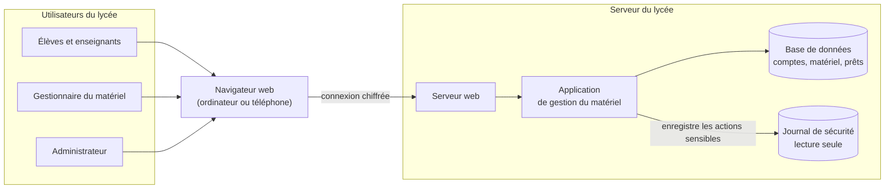
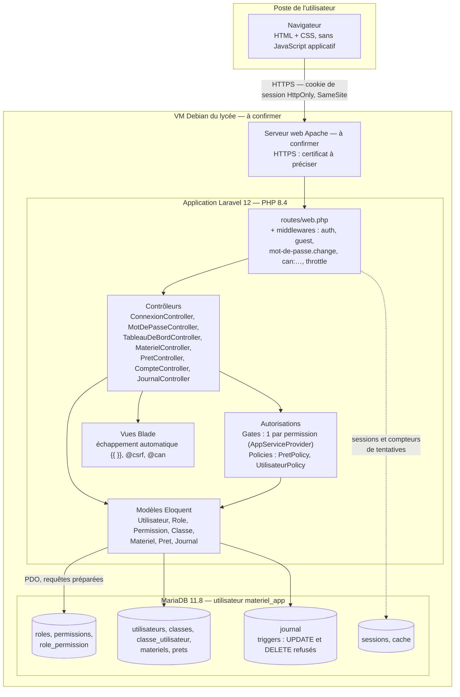

# Architecture de l'application

Ce document présente l'application en deux vues :

1. une **vue fonctionnelle**, sans détail technique, compréhensible par une personne non développeuse (professeur, jury, lycée) ;
2. une **vue technique**, qui reprend les mêmes blocs avec les technologies, les composants réels du code et les mécanismes de sécurité.

Les informations pas encore décidées sont marquées **à préciser** ; celles qui sont prévues mais pas encore validées sont marquées **à confirmer**.

> Dernière mise à jour : étape 9, après les étapes 1 à 8 (connexion, autorisations, inventaire, prêts, journal, comptes, tests).

---

## 1. Schéma fonctionnel

### Rôle de chaque bloc

- **Utilisateurs du lycée** : chaque personne a **un seul rôle** (élève, enseignant, gestionnaire ou administrateur). Le rôle décide de ce qu'elle voit et de ce qu'elle a le droit de faire. Une personne non connectée ne voit que la page de connexion.
- **Navigateur web** : c'est l'outil que l'utilisateur utilise déjà (Firefox, Chrome), sur un ordinateur ou un téléphone. Il n'y a rien à installer.
- **Serveur web** : il reçoit les demandes des navigateurs et les transmet à l'application. La connexion entre le navigateur et le serveur doit être **chiffrée** (HTTPS) pour que personne ne puisse lire les mots de passe en chemin.
- **Application de gestion du matériel** : c'est le cœur du projet. Elle vérifie **qui** fait la demande (connexion), **s'il a le droit** de la faire (autorisations), puis réalise l'action : afficher le catalogue, enregistrer une demande de prêt, valider, enregistrer une sortie ou un retour…
- **Base de données** : elle garde toutes les informations : les comptes et leurs rôles, les classes, l'inventaire du matériel et l'historique de tous les prêts.
- **Journal de sécurité** : il garde la trace des actions sensibles (connexions, accès refusés, changements de rôle, décisions sur les prêts) avec la date, l'auteur et l'adresse de l'ordinateur. **Personne ne peut le modifier ni l'effacer**, pas même l'administrateur : il sert de preuve en cas de problème. Techniquement, c'est une partie de la base de données, protégée à part.

---

## 2. Schéma technique

### 2.1 Poste de l'utilisateur

- **Navigateur** : les pages sont du HTML produit par le serveur, avec une seule feuille de style (`public/css/app.css`). Il n'y a pas de JavaScript applicatif, en dehors de quelques confirmations (« Archiver ce matériel ? »).
  *Pourquoi* : rien à compiler (pas de Node.js ni de `npm`), et toutes les règles sont vérifiées **côté serveur**. Ce qui s'affiche ou se cache dans le navigateur ne protège rien (RA-02).

### 2.2 Serveur web et hébergement

| Élément | Valeur |
| --- | --- |
| Système | Machine virtuelle Debian du lycée — **à confirmer** |
| Serveur web | Apache — **à confirmer** |
| HTTPS | Certificat auto-signé en test ; certificat définitif **à préciser** |
| Nom de domaine | **à préciser** |
| En développement | `php artisan serve`, en HTTP sur `127.0.0.1:8000` |

- **HTTPS** (ES-09) chiffre tout ce qui circule, en particulier les mots de passe et le cookie de session. Il se configure sur le serveur web, pas dans le code. Il faudra ensuite ajouter `SESSION_SECURE_COOKIE=true` dans `.env`, pour que le cookie de session ne soit jamais envoyé en HTTP simple (ES-08).

### 2.3 Application Laravel 12 (PHP 8.4)

*Pourquoi Laravel* : il est imposé par le cahier des charges et vu en BTS SIO. Il fournit, sans package supplémentaire, tout ce dont la sécurité a besoin : hachage des mots de passe, protection CSRF, sessions, Gates et Policies, requêtes préparées, échappement dans les vues.

#### Le trajet d'une requête

Une requête traverse quatre filtres avant d'arriver au contrôleur. Elle s'arrête au premier qui répond non.

1. **`auth`** — *qui es-tu ?* Un visiteur non connecté est renvoyé vers `/connexion`.
2. **`mot-de-passe.change`** — un utilisateur qui a encore son mot de passe temporaire est renvoyé vers `/mot-de-passe` (section 5.6).
3. **`can:permission`** — *ton rôle a-t-il la permission ?* Le Gate lit la table `role_permission`. Si la réponse est non, Laravel renvoie **403**.
4. **Policy, dans le contrôleur** — *cet objet précis est-il dans ton périmètre ?* Par exemple : ce prêt est-il le tien, ou celui d'un élève de ta classe ? Ce n'est pas ta propre demande ?

#### Routes principales

| Adresse | Contrôleur | Protection |
| --- | --- | --- |
| `GET/POST /connexion`, `POST /deconnexion` | `Auth\ConnexionController` | `guest` ; `throttle:10,1` sur le POST |
| `GET/POST /mot-de-passe` | `Auth\MotDePasseController` | `auth` ; `throttle:10,1` sur le POST |
| `GET /tableau-de-bord` | `TableauDeBordController` | `auth` ; chaque bloc dépend d'une permission |
| `GET /materiels` | `MaterielController` | `can:materiel.voir` |
| `/materiels/nouveau`, `/materiels/{id}/modifier`, `…/archiver` | `MaterielController` | `can:materiel.gerer` |
| `GET /prets`, `GET /prets/{id}` | `PretController` | `can:pret.voir` + `PretPolicy::view` |
| `/prets/nouveau`, `POST /prets` | `PretController` | `can:pret.demander` |
| `PATCH /prets/{id}/valider`, `refuser`, `annuler`, `sortie`, `retour` | `PretController` | `PretPolicy` (valider, annuler, sortir, rendre) |
| `/comptes…` (liste, création, modification, rôle, désactivation) | `CompteController` | `can:compte.gerer` + `UtilisateurPolicy` |
| `GET /journal` | `JournalController` | `can:journal.voir` ; **aucune route de modification** |

#### Autorisations : Gates et Policies

Le détail complet (matrice, règles RA-01 à RA-08, procédure pour ajouter une permission) est dans [autorisations.md](autorisations.md).

- **Un Gate par permission** (`AppServiceProvider`). Les 11 noms viennent de `Permission::LISTE`. **Quel rôle a quelle permission** est stocké en base, dans `role_permission` : on peut ajuster la matrice sans réécrire le code (section 5.5).
  *Refus par défaut* (RA-01) : une permission absente de la table, ou un visiteur non connecté, donne toujours « non ».
- **`PretPolicy`** : `view` (RA-03), `valider` (RA-04 + périmètre de classe), `annuler`, `sortir`, `rendre`.
- **`UtilisateurPolicy`** : `update`, `changerRole` et `desactiver` (RA-05 : jamais sur soi-même, jamais le dernier administrateur actif, pas de matériel non rendu), `reactiver`. Les refus renvoient une **raison** (`Response::deny`), affichée à l'administrateur.
- **Anti-IDOR** : `PretController::trouverPretAutorise()` est le seul point d'entrée pour agir sur un prêt. Un prêt **inexistant** et un prêt **hors périmètre** donnent exactement la même réponse 403 : on ne peut pas deviner quels prêts existent en changeant le numéro dans l'adresse.
- La règle « qui voit quel prêt » existe en PHP (`PretPolicy::view`, pour le détail) et en SQL (`Pret::visiblesPar`, pour la liste). Le test `CoherenceVisibilitePretsTest` vérifie que les deux disent toujours la même chose.

#### Modèles et vues

- **Eloquent** : chaque modèle indique sa table française (`protected $table = 'prets'`). Les colonnes sensibles ne sont **pas** remplissables d'un coup par un formulaire. Par exemple, `statut`, `validateur_id` et `mot_de_passe_hash` ne changent que par du code écrit exprès.
- **Blade** : tout est affiché avec `{{ }}`, qui échappe le HTML (ES-06). Chaque formulaire contient `@csrf` (ES-07). `@can` cache les boutons inutiles, pour le confort seulement : la protection réelle reste sur le serveur.

#### Commande du premier administrateur

`php artisan materiel:creer-admin` (`app/Console/Commands/CreerAdministrateur.php`) crée un administrateur depuis le terminal du serveur : elle demande le prénom, le nom et l'e-mail, génère un mot de passe temporaire et écrit la création dans le journal.
*Pourquoi une commande plutôt qu'un seeder* : en production, aucun mot de passe ne doit être écrit dans le code. Et seule une personne qui a accès au terminal du serveur peut la lancer : il n'existe aucune page web équivalente.

### 2.4 Base de données MariaDB 11.8

- **Utilisateur dédié `materiel_app`**, avec des droits sur la seule base `gestion_materiel`. L'application n'utilise jamais `root`.
- **Accès uniquement par Eloquent et le Query Builder**, qui préparent les requêtes (ES-05). Les valeurs tapées par l'utilisateur ne sont jamais collées dans le SQL.
- **Noms de tables et de colonnes en français**, d'après le modèle logique (cahier des charges, section 7.2).

| Groupe | Tables | Remarques |
| --- | --- | --- |
| Droits | `roles`, `permissions`, `role_permission` | La matrice rôles / permissions |
| Métier | `utilisateurs`, `classes`, `classe_utilisateur`, `materiels`, `prets` | Clés étrangères `restrictOnDelete` : impossible de supprimer un matériel ou un utilisateur qui a un historique de prêts (BF-11) |
| Journal | `journal` | Deux **triggers** MariaDB refusent `UPDATE` et `DELETE`, même en SQL direct. `date_heure` est fournie par Laravel (`Europe/Paris`) et n'a pas de valeur par défaut. |
| Technique | `sessions`, `cache`, `password_reset_tokens`, `jobs` | Tables de Laravel (noms anglais). `sessions` permet de fermer les sessions d'un utilisateur (RA-06). `cache` garde les compteurs de tentatives. |

*Pourquoi des triggers* : le modèle `Journal` refuse déjà toute modification dans le code. Les triggers ajoutent une **deuxième protection**, au niveau de la base, qui tient même si le code est contourné (défense en profondeur).

### 2.5 Sécurité : où chaque exigence est appliquée

| Exigence | Mise en œuvre | Preuve |
| --- | --- | --- |
| ES-01 Mots de passe hachés | `Hash::make()` (bcrypt), colonne `mot_de_passe_hash` cachée du modèle | — |
| ES-02 12 caractères minimum | `Password::min(12)` dans `MotDePasseController` | — |
| ES-03 Blocage après 5 échecs | Colonnes `echecs_connexion` / `bloque_jusqua` ; `RateLimiter` pour les e-mails inconnus ; `throttle:10,1` par adresse IP | Test manuel (étape 3) |
| ES-04 Message identique | « Identifiants incorrects. » dans tous les cas, plus un faux hachage pour un temps de réponse identique | `AutorisationsTest` |
| ES-05 Injection SQL | Eloquent / Query Builder uniquement | — |
| ES-06 XSS | `{{ }}` dans Blade, jamais `{!! !!}` | Test manuel (`<script>` affiché comme du texte) |
| ES-07 CSRF | `@csrf` dans chaque formulaire, vérifié par Laravel | Test manuel (419 sans jeton) |
| ES-08 Session | `session()->regenerate()` après connexion ; cookie `HttpOnly` et `SameSite=lax` ; `Secure` **à activer avec HTTPS** ; sessions chiffrées | — |
| ES-09 HTTPS | Sur le serveur web — **à configurer** | — |
| ES-10 Validation | `$request->validate()` dans chaque contrôleur | — |
| ES-11 Pas d'erreur technique | `APP_DEBUG=false` en production ; pages 403, 404, 429 en français | — |
| RA-01 / RA-02 Refus par défaut, contrôle serveur | Gates + middleware `can:` sur chaque route | `AutorisationsTest` |
| RA-03 Propriétaire (IDOR) | `PretPolicy::view` + `trouverPretAutorise()` | `AutorisationsTest`, `CoherenceVisibilitePretsTest` |
| RA-04 Séparation des tâches | `PretPolicy::valider` | `AutorisationsTest` |
| RA-05 Protection des admins | `UtilisateurPolicy` | `AutorisationsTest` |
| RA-06 Effet immédiat | `Utilisateur::fermerSessions()` au changement de rôle et à la désactivation | `AutorisationsTest` |
| RA-07 Limite de prêts | `MAX_PRETS_EN_COURS_ELEVE` (valeur **à préciser** avec le lycée) | Test manuel (étape 6) |
| RA-08 Refus discret et journalisé | Page `errors/403.blade.php` ; journalisation de tous les 403 dans `bootstrap/app.php` | `AutorisationsTest` |

---

## 3. Informations à préciser

| Information | Où elle intervient |
| --- | --- |
| Confirmation de l'hébergement (VM Debian du lycée, Apache) | Schéma technique, mise en production |
| Nom de domaine et certificat HTTPS | `APP_URL`, `SESSION_SECURE_COOKIE` |
| Nombre maximum de prêts en cours par élève (RA-07) | `.env` : `MAX_PRETS_EN_COURS_ELEVE` |
| Durées de conservation RGPD et contact du responsable | Page de connexion, purge du journal |

---

## 4. Évolutions prévues, pas encore développées

- Rappels de retour par e-mail (BF-23) et réinitialisation du mot de passe par e-mail (BF-03).
- Création des classes et import CSV des comptes à la rentrée (section 5.6).
- Demande de prêt d'un enseignant pour une classe entière (section 3).
