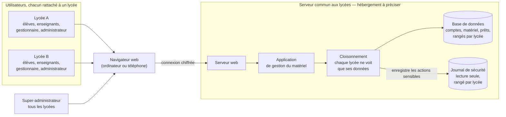
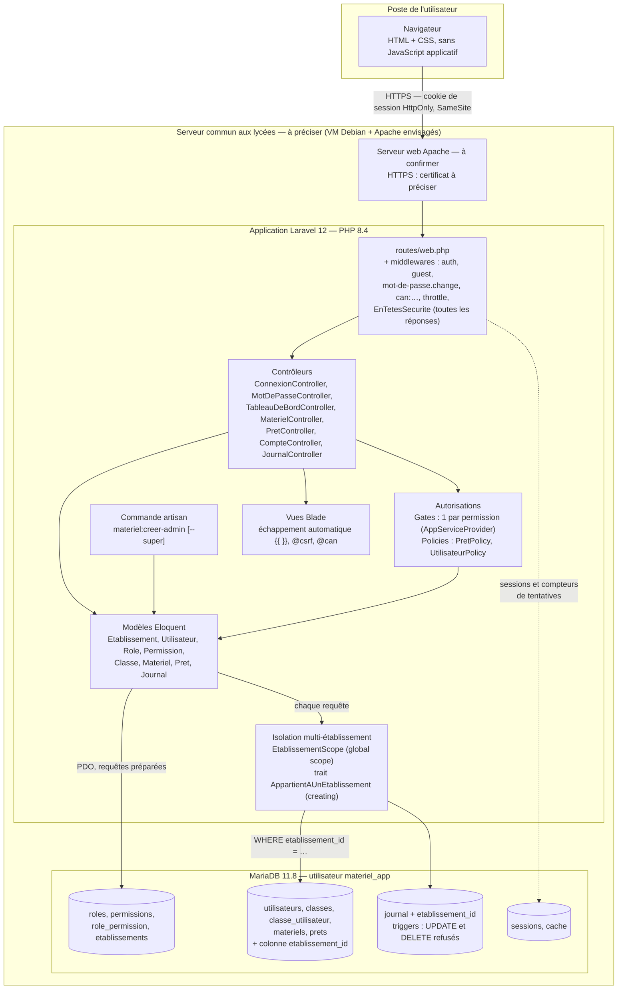

# Architecture de l'application

Ce document présente l'application en deux vues :

1. une **vue fonctionnelle**, sans détail technique, compréhensible par une personne non développeuse (professeur, jury, lycée) ;
2. une **vue technique**, qui reprend les mêmes blocs avec les technologies, les composants réels du code et les mécanismes de sécurité.

Les informations pas encore décidées sont marquées **à préciser** ; celles qui sont prévues mais pas encore validées sont marquées **à confirmer**.

> Dernière mise à jour : passage en **multi-établissement** (branche `multi-etablissement`) : plusieurs lycées partagent l'application, chacun ne voit que ses propres données.

---

## 1. Schéma fonctionnel

### Rôle de chaque bloc

- **Utilisateurs, chacun rattaché à un lycée** : chaque personne appartient à **un seul lycée** et a **un seul rôle** (élève, enseignant, gestionnaire ou administrateur). Le rôle décide de ce qu'elle a le droit de faire ; le lycée décide des données qu'elle peut voir. Une personne non connectée ne voit que la page de connexion.
- **Super-administrateur** : un compte à part, rattaché à **aucun** lycée, qui voit les données de tous les lycées. Il a les mêmes droits qu'un administrateur. Il ne peut pas être créé depuis l'application, seulement depuis le serveur.
- **Navigateur web** : c'est l'outil que l'utilisateur utilise déjà (Firefox, Chrome), sur un ordinateur ou un téléphone. Il n'y a rien à installer.
- **Serveur web** : il reçoit les demandes des navigateurs et les transmet à l'application. La connexion entre le navigateur et le serveur doit être **chiffrée** (HTTPS) pour que personne ne puisse lire les mots de passe en chemin.
- **Application de gestion du matériel** : c'est le cœur du projet. Elle vérifie **qui** fait la demande (connexion), **s'il a le droit** de la faire (autorisations), puis réalise l'action : afficher le catalogue, enregistrer une demande de prêt, valider, enregistrer une sortie ou un retour…
- **Cloisonnement** : avant de lire ou d'écrire dans la base, l'application ajoute automatiquement « seulement le lycée de la personne connectée ». Un utilisateur du lycée A ne peut ni voir ni modifier une donnée du lycée B, même en tapant son adresse à la main : pour lui, elle n'existe pas.
- **Base de données** : elle garde toutes les informations : les comptes et leurs rôles, les classes, l'inventaire du matériel et l'historique de tous les prêts. Chaque information porte le nom de son lycée. Deux lycées peuvent avoir le même numéro d'inventaire ou le même nom de classe.
- **Journal de sécurité** : il garde la trace des actions sensibles (connexions, accès refusés, changements de rôle, décisions sur les prêts) avec la date, l'auteur et l'adresse de l'ordinateur. **Personne ne peut le modifier ni l'effacer**, pas même l'administrateur : il sert de preuve en cas de problème. Chaque administrateur ne voit que le journal de son lycée. Techniquement, c'est une partie de la base de données, protégée à part.

---

## 2. Schéma technique

### 2.1 Poste de l'utilisateur

- **Navigateur** : les pages sont du HTML produit par le serveur, avec une seule feuille de style (`public/css/app.css`). Il n'y a pas de JavaScript applicatif, en dehors de quelques confirmations (« Archiver ce matériel ? »).
  *Pourquoi* : rien à compiler (pas de Node.js ni de `npm`), et toutes les règles sont vérifiées **côté serveur**. Ce qui s'affiche ou se cache dans le navigateur ne protège rien (RA-02).

### 2.2 Serveur web et hébergement

| Élément | Valeur |
| --- | --- |
| Système | Machine virtuelle Debian — **à confirmer**. Avec plusieurs lycées, **qui héberge le serveur commun** (un lycée, le rectorat, un prestataire) est **à préciser** |
| Serveur web | Apache — **à confirmer** |
| HTTPS | Certificat auto-signé en test ; certificat définitif **à préciser** |
| Nom de domaine | **à préciser** |
| En développement | `php artisan serve`, en HTTP sur `127.0.0.1:8000` |

- **HTTPS** (ES-09) chiffre tout ce qui circule, en particulier les mots de passe et le cookie de session. Il se configure sur le serveur web, pas dans le code. Il faudra ensuite ajouter `SESSION_SECURE_COOKIE=true` dans `.env`, pour que le cookie de session ne soit jamais envoyé en HTTP simple (ES-08).
- **Un seul serveur et une seule base pour tous les lycées** : c'est l'application qui cloisonne les données (section 2.3, « Isolation entre établissements »), pas l'hébergement.

### 2.3 Application Laravel 12 (PHP 8.4)

*Pourquoi Laravel* : il est imposé par le cahier des charges et vu en BTS SIO. Il fournit, sans package supplémentaire, tout ce dont la sécurité a besoin : hachage des mots de passe, protection CSRF, sessions, Gates et Policies, global scopes, requêtes préparées, échappement dans les vues.

#### Le trajet d'une requête

Une requête traverse quatre filtres avant d'arriver au contrôleur. Elle s'arrête au premier qui répond non.

1. **`auth`** — *qui es-tu ?* Un visiteur non connecté est renvoyé vers `/connexion`.
2. **`mot-de-passe.change`** — un utilisateur qui a encore son mot de passe temporaire est renvoyé vers `/mot-de-passe` (section 5.6).
3. **`can:permission`** — *ton rôle a-t-il la permission ?* Le Gate lit la table `role_permission`. Si la réponse est non, Laravel renvoie **403**.
4. **Policy, dans le contrôleur** — *cet objet précis est-il dans ton périmètre ?* Par exemple : ce prêt est-il le tien, ou celui d'un élève de ta classe ? Ce n'est pas ta propre demande ?

En plus, **à chaque lecture en base**, `EtablissementScope` ajoute *« seulement ton établissement »*. Une donnée d'un autre lycée n'est donc jamais trouvée : elle donne la même réponse qu'un id inexistant (404 pour un matériel ou un compte, 403 pour un prêt, voir RA-03).

#### Routes principales

| Adresse | Contrôleur | Protection |
| --- | --- | --- |
| `GET/POST /connexion`, `POST /deconnexion` | `Auth\ConnexionController` | `guest` ; `throttle:10,1` sur le POST |
| `GET/POST /mot-de-passe` | `Auth\MotDePasseController` | `auth` ; `throttle:10,1` sur le POST |
| `GET /tableau-de-bord` | `TableauDeBordController` | `auth` ; chaque bloc dépend d'une permission |
| `GET /materiels` | `MaterielController` | `can:materiel.voir` |
| `/materiels/nouveau`, `/materiels/{id}/modifier`, `…/archiver` | `MaterielController` | `can:materiel.gerer` |
| `GET /prets`, `GET /prets/{id}` | `PretController` | `can:pret.voir` + `PretPolicy::view` |
| `/prets/nouveau`, `POST /prets` | `PretController` | `can:pret.demander` |
| `PATCH /prets/{id}/valider`, `refuser`, `annuler`, `sortie`, `retour` | `PretController` | `PretPolicy` (valider, annuler, sortir, rendre) |
| `/comptes…` (liste, création, modification, rôle, désactivation) | `CompteController` | `can:compte.gerer` + `UtilisateurPolicy` |
| `GET /journal` | `JournalController` | `can:journal.voir` ; **aucune route de modification** |

Toutes ces routes sont aussi soumises à l'isolation entre établissements.

#### Autorisations : Gates et Policies

Le détail complet (matrice, règles RA-01 à RA-08, isolation, procédures) est dans [autorisations.md](autorisations.md).

- **Un Gate par permission** (`AppServiceProvider`). Les 11 noms viennent de `Permission::LISTE`. **Quel rôle a quelle permission** est stocké en base, dans `role_permission` : on peut ajuster la matrice sans réécrire le code (section 5.5).
  *Refus par défaut* (RA-01) : une permission absente de la table, ou un visiteur non connecté, donne toujours « non ».
- **`PretPolicy`** : `view` (RA-03), `valider` (RA-04 + périmètre de classe), `annuler`, `sortir`, `rendre`.
- **`UtilisateurPolicy`** : `update`, `changerRole` et `desactiver` (RA-05 : jamais sur soi-même, jamais le dernier administrateur actif **de l'établissement**, pas de matériel non rendu), `reactiver`. Les refus renvoient une **raison** (`Response::deny`), affichée à l'administrateur.
- **Rôle `super_admin`** : mêmes permissions que l'administrateur. Il n'est **jamais** attribuable depuis les écrans de comptes : `CompteController` n'accepte que les rôles de la liste blanche `Role::ATTRIBUABLES_PAR_FORMULAIRE`, même si quelqu'un envoie à la main l'id du rôle `super_admin`.
- **Anti-IDOR** : `PretController::trouverPretAutorise()` est le seul point d'entrée pour agir sur un prêt. Un prêt **inexistant**, un prêt **hors périmètre** et un prêt **d'un autre lycée** donnent exactement la même réponse 403 : on ne peut pas deviner quels prêts existent en changeant le numéro dans l'adresse.
- La règle « qui voit quel prêt » existe en PHP (`PretPolicy::view`, pour le détail) et en SQL (`Pret::visiblesPar`, pour la liste). Le test `CoherenceVisibilitePretsTest` vérifie que les deux disent toujours la même chose.

#### Isolation entre établissements (multi-établissement)

| Mécanisme | Fichier | Rôle |
| --- | --- | --- |
| Table `etablissements` et colonne `etablissement_id` | migrations `2026_10_29_100001` et `100002` | Chaque donnée porte son lycée |
| **Global scope** `EtablissementScope` | `app/Models/Scopes/EtablissementScope.php` | Ajoute `WHERE <table>.etablissement_id = <lycée de l'utilisateur connecté>` à **chaque** requête Eloquent : listes, `find()`, liaison de route `{materiel}` / `{compte}`, `whereHas`… |
| **Trait** `AppartientAUnEtablissement` | `app/Models/Concerns/AppartientAUnEtablissement.php` | Branche le scope et l'événement `creating` sur `Utilisateur`, `Materiel`, `Pret`, `Classe` |
| **Événement `creating`** | même trait | À la création, `etablissement_id` prend **toujours** le lycée de l'utilisateur connecté, même si le code a mis une autre valeur |
| Filtres écrits à la main | `PretController`, `CompteController`, `MaterielController` | Là où le scope ne passe pas (voir ci-dessous) |

Les règles du scope, dans l'ordre :

1. **Personne n'est connecté** (page de connexion, commande artisan, seeders) : pas de filtre. Sinon la connexion ne pourrait pas trouver le compte à partir de l'e-mail.
2. **Super-administrateur** : pas de filtre, il voit tout.
3. **Compte sans établissement** qui n'est pas super-admin : il ne voit **rien** (`1 = 0`). Sans cette garde, `where(colonne, null)` deviendrait `IS NULL` et le compte verrait les super-admins et l'ancien journal.
4. **Sinon** : filtre sur son établissement.

*Pourquoi un global scope plutôt qu'un `where` dans chaque contrôleur* : un `where` oublié dans un seul écran suffirait à créer une fuite. Le scope est appliqué par Laravel lui-même, y compris dans les écrans qui seront ajoutés plus tard.

*Pourquoi `Auth::hasUser()` et pas `Auth::user()`* : à chaque requête, Laravel recharge l'utilisateur connecté avec `Utilisateur::find()`, qui passe par le scope. Si le scope appelait `Auth::user()`, il relancerait ce chargement : **boucle infinie**. `hasUser()` répond seulement « l'utilisateur est-il déjà chargé ? ».

**Là où le scope ne s'applique PAS**, et ce qui le remplace :

| Cas | Pourquoi le scope ne passe pas | Ce qui protège |
| --- | --- | --- |
| `Rule::exists` / `Rule::unique` (validation) | Requêtes directes, sans Eloquent | `->where('etablissement_id', …)` écrit dans la règle : matériel d'un prêt, classes d'un compte, numéro d'inventaire unique par établissement |
| `DB::table(...)` | Requêtes directes, sans Eloquent | Utilisé seulement dans les seeders et pour la table `sessions`, qui n'est pas propre à un établissement |
| Journal | Le trait exigerait un établissement à la création, même pour le super-admin, dont la propre connexion serait alors refusée | Scope seul (`Journal::booted`) ; `Journal::enregistrer()` prend l'établissement **de l'auteur**, même quand personne n'est connecté (connexion échouée) |

- **`etablissement_id` n'est jamais dans `$fillable`** : un formulaire ne peut pas choisir l'établissement (protection contre l'assignation de masse).
- **Super-administrateur** : `etablissement_id` vide, rôle `super_admin`. Créé seulement par `php artisan materiel:creer-admin --super`. S'il crée une donnée depuis le web sans préciser l'établissement, l'application refuse (erreur) plutôt que de créer une donnée sans lycée.
- **Preuve** : `IsolationEtablissementsTest` (9 tests), voir le [cahier de tests](cahier-de-tests.md).

#### Modèles et vues

- **Eloquent** : chaque modèle indique sa table française (`protected $table = 'prets'`). Les colonnes sensibles ne sont **pas** remplissables d'un coup par un formulaire. Par exemple, `statut`, `validateur_id`, `mot_de_passe_hash` et `etablissement_id` ne changent que par du code écrit exprès.
- **Blade** : tout est affiché avec `{{ }}`, qui échappe le HTML (ES-06). Aucune vue ne contient de JavaScript ou de CSS écrit dans le HTML : la *Content-Security-Policy* l'interdirait. Les confirmations (« Archiver ce matériel ? ») passent par l'attribut `data-confirmation` et le fichier `public/js/confirmation.js`. Chaque formulaire contient `@csrf` (ES-07). `@can` cache les boutons inutiles, pour le confort seulement : la protection réelle reste sur le serveur.

#### Commande des administrateurs

`php artisan materiel:creer-admin` (`app/Console/Commands/CreerAdministrateur.php`) crée un administrateur depuis le terminal du serveur : elle demande le prénom, le nom, l'e-mail et **l'établissement** (choisi dans une liste), génère un mot de passe temporaire et écrit la création dans le journal.

Avec l'option `--super`, elle crée un **super-administrateur**, sans établissement. C'est le seul moyen d'en créer un.

*Pourquoi une commande plutôt qu'un seeder* : en production, aucun mot de passe ne doit être écrit dans le code. Et seule une personne qui a accès au terminal du serveur peut la lancer : il n'existe aucune page web équivalente.

### 2.4 Base de données MariaDB 11.8

- **Utilisateur dédié `materiel_app`**, avec des droits sur la seule base `gestion_materiel`. L'application n'utilise jamais `root`.
- **Accès uniquement par Eloquent et le Query Builder**, qui préparent les requêtes (ES-05). Les valeurs tapées par l'utilisateur ne sont jamais collées dans le SQL.
- **Noms de tables et de colonnes en français**, d'après le modèle logique (cahier des charges, section 7.2).

| Groupe | Tables | Remarques |
| --- | --- | --- |
| Droits | `roles`, `permissions`, `role_permission` | La matrice rôles / permissions, commune à tous les lycées. 5 rôles, dont `super_admin` |
| Établissements | `etablissements` (`id`, `nom` unique) | Créée avec l'établissement par défaut « Lycée Saint-Joseph ». Clés étrangères `restrictOnDelete` : impossible de supprimer un lycée qui a encore des données |
| Métier | `utilisateurs`, `classes`, `classe_utilisateur`, `materiels`, `prets` | Colonne `etablissement_id` **obligatoire** sur `materiels`, `prets`, `classes` ; **facultative** sur `utilisateurs` (vide = super-admin). Clés uniques **composites** `(etablissement_id, numero_inventaire)` et `(etablissement_id, nom)` pour les classes. L'e-mail reste unique sur tout le site (identifiant de connexion). Clés étrangères `restrictOnDelete` : impossible de supprimer un matériel ou un utilisateur qui a un historique de prêts (BF-11) |
| Journal | `journal` | Colonne `etablissement_id` facultative (vide pour les lignes d'avant le multi-établissement, les e-mails inconnus et les actions du super-admin). Deux **triggers** MariaDB refusent `UPDATE` et `DELETE`, même en SQL direct. `date_heure` est fournie par Laravel (`Europe/Paris`) et n'a pas de valeur par défaut. |
| Technique | `sessions`, `cache`, `password_reset_tokens`, `jobs` | Tables de Laravel (noms anglais). `sessions` permet de fermer les sessions d'un utilisateur (RA-06). `cache` garde les compteurs de tentatives. |

*Pourquoi des triggers* : le modèle `Journal` refuse déjà toute modification dans le code. Les triggers ajoutent une **deuxième protection**, au niveau de la base, qui tient même si le code est contourné (défense en profondeur).

*Pourquoi les lignes du journal d'avant le multi-établissement restent sans établissement* : les triggers interdisent tout `UPDATE`, donc on ne peut pas les rattacher après coup. C'est voulu : même une migration ne doit pas pouvoir réécrire le journal.

### 2.5 Sécurité : où chaque exigence est appliquée

| Exigence | Mise en œuvre | Preuve |
| --- | --- | --- |
| ES-01 Mots de passe hachés | `Hash::make()` (bcrypt), colonne `mot_de_passe_hash` cachée du modèle | — |
| ES-02 12 caractères minimum | `Password::min(12)` dans `MotDePasseController` | — |
| ES-03 Blocage après 5 échecs | Colonnes `echecs_connexion` / `bloque_jusqua` ; `RateLimiter` pour les e-mails inconnus ; `throttle:10,1` par adresse IP | Test manuel (étape 3) |
| ES-04 Message identique | « Identifiants incorrects. » dans tous les cas, plus un faux hachage pour un temps de réponse identique | `AutorisationsTest` |
| ES-05 Injection SQL | Eloquent / Query Builder uniquement | — |
| ES-06 XSS | `{{ }}` dans Blade, jamais `{!! !!}` | Test manuel (`<script>` affiché comme du texte) |
| ES-07 CSRF | `@csrf` dans chaque formulaire, vérifié par Laravel | Test manuel (419 sans jeton) |
| ES-08 Session | `session()->regenerate()` après connexion ; cookie `HttpOnly` et `SameSite=lax` ; `Secure` **à activer avec HTTPS** ; sessions chiffrées | — |
| ES-09 HTTPS | Sur le serveur web — **à configurer** | — |
| ES-10 Validation | `$request->validate()` dans chaque contrôleur | — |
| ES-11 Pas d'erreur technique | `APP_DEBUG=false` en production ; pages 403, 404, 405, 419, 429, 500 en français, sans détail technique | — |
| En-têtes HTTP (audit OWASP ZAP) | Middleware `EnTetesSecurite` sur toutes les réponses : `X-Frame-Options: DENY`, `X-Content-Type-Options: nosniff`, `Referrer-Policy: same-origin`, `Content-Security-Policy` stricte (tout depuis le serveur, aucun script ni style dans le HTML), HSTS en HTTPS seulement, `X-Powered-By` retiré | `EnTetesSecuriteTest` + vérification dans Chromium |
| RA-01 / RA-02 Refus par défaut, contrôle serveur | Gates + middleware `can:` sur chaque route | `AutorisationsTest` |
| RA-03 Propriétaire (IDOR) | `PretPolicy::view` + `trouverPretAutorise()` | `AutorisationsTest`, `CoherenceVisibilitePretsTest` |
| RA-04 Séparation des tâches | `PretPolicy::valider` | `AutorisationsTest` |
| RA-05 Protection des admins | `UtilisateurPolicy` ; « dernier administrateur actif » compté par établissement | `AutorisationsTest` |
| RA-06 Effet immédiat | `Utilisateur::fermerSessions()` au changement de rôle et à la désactivation | `AutorisationsTest` |
| RA-07 Limite de prêts | `MAX_PRETS_EN_COURS_ELEVE` (valeur **à préciser** avec le lycée) | Test manuel (étape 6) |
| RA-08 Refus discret et journalisé | Page `errors/403.blade.php` ; journalisation de tous les 403 dans `bootstrap/app.php` | `AutorisationsTest` |
| Isolation entre établissements | `EtablissementScope` + trait `AppartientAUnEtablissement` ; filtres dans `Rule::exists` / `Rule::unique` ; journal par auteur | `IsolationEtablissementsTest` |
| Rôle super-admin non attribuable | Liste blanche `Role::ATTRIBUABLES_PAR_FORMULAIRE` ; création par la commande `--super` seulement | `AutorisationsTest`, `CreerAdministrateurTest` |

---

## 3. Informations à préciser

| Information | Où elle intervient |
| --- | --- |
| Hébergement du serveur **commun aux lycées** : qui l'héberge et l'administre (un lycée, le rectorat, un prestataire), VM Debian et Apache à confirmer | Schéma technique, mise en production |
| Qui détient le compte **super-administrateur** | Commande `materiel:creer-admin --super`, procédures |
| Liste réelle des établissements (en dehors du « Lycée Saint-Joseph » par défaut) | Table `etablissements` |
| Nom de domaine et certificat HTTPS | `APP_URL`, `SESSION_SECURE_COOKIE` |
| Nombre maximum de prêts en cours par élève (RA-07), commun à tous les lycées ou propre à chacun | `.env` : `MAX_PRETS_EN_COURS_ELEVE` |
| Durées de conservation RGPD et contact du responsable (un par lycée ?) | Page de connexion, purge du journal |

---

## 4. Évolutions prévues, pas encore développées

- Rappels de retour par e-mail (BF-23) et réinitialisation du mot de passe par e-mail (BF-03).
- Création des classes et import CSV des comptes à la rentrée (section 5.6).
- Demande de prêt d'un enseignant pour une classe entière (section 3).
- **Multi-établissement** :
  - un écran ou une commande pour **créer un établissement** (aujourd'hui : un `INSERT` SQL, voir le README) ;
  - un écran de choix de l'établissement pour le **super-administrateur**, pour qu'il puisse créer des comptes ou du matériel depuis le web (aujourd'hui : refusé) ;
  - écrire dans le journal **du lycée concerné** les actions du super-administrateur (aujourd'hui : sans établissement, donc invisibles pour l'administrateur du lycée).
