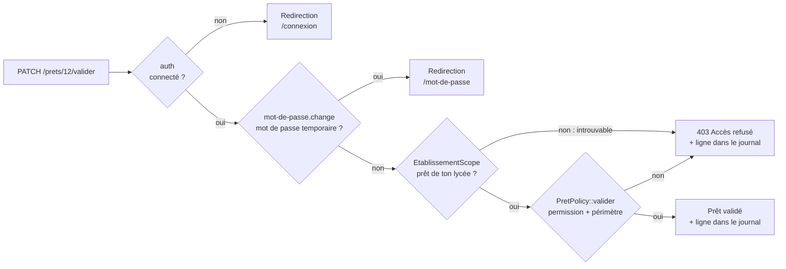

# Autorisations : rôles, permissions et règles RA-01 à RA-08

Ce document décrit **qui a le droit de faire quoi** dans l'application, et **comment le code l'applique**.
Il reprend les sections 5.2 à 5.4 du [cahier des charges](cahier-des-charges.md) et les relie aux fichiers du projet.

Pour la vue d'ensemble de l'application, voir [architecture.md](architecture.md).

---

## 1. Principe : trois questions à chaque requête

Toute action est **interdite par défaut**. Elle n'est permise que si toutes les réponses sont « oui ».

| Question | Mécanisme Laravel | Où dans le code |
| --- | --- | --- |
| **1. Qui es-tu ?** (connecté, compte actif) | Middleware `auth` | [routes/web.php](../routes/web.php), [bootstrap/app.php](../bootstrap/app.php#L18) |
| **2a. Ton rôle a-t-il la permission ?** | **Gate**, appelé par le middleware `can:…` ou par `@can` | [AppServiceProvider.php](../app/Providers/AppServiceProvider.php#L37) |
| **2b. Cet objet est-il dans ton périmètre ?** (tes prêts, tes classes, pas ta propre demande) | **Policy**, appelée dans le contrôleur | [PretPolicy.php](../app/Policies/PretPolicy.php), [UtilisateurPolicy.php](../app/Policies/UtilisateurPolicy.php) |
| **3. Cette donnée est-elle de ton établissement ?** | **Global scope**, ajouté automatiquement à chaque requête Eloquent (section 4) | [EtablissementScope.php](../app/Models/Scopes/EtablissementScope.php) |

### Le trajet d'une requête

Exemple : un enseignant clique sur « Valider » pour le prêt n° 12.



### Gate ou Policy : qui fait quoi ?

- **Gate** : répond seulement « ce **rôle** a-t-il cette **permission** ? ».
  Il y a un Gate par permission, créé dans [AppServiceProvider::definirUnGateParPermission()](../app/Providers/AppServiceProvider.php#L37). Il appelle [Utilisateur::aLaPermission()](../app/Models/Utilisateur.php#L146), qui lit la table `role_permission`.
- **Policy** : répond « cet **utilisateur** peut-il faire cette action sur **cet objet précis** ? ».
  Elle commence toujours par vérifier la permission, puis applique le périmètre : à qui appartient le prêt, dans quel statut il est, s'il s'agit de sa propre demande.

Les restrictions de périmètre (« les siens », « ses classes ») ne sont **pas** dans les tables : ce sont des règles écrites dans les Policies (cahier des charges, section 5.5).

Le cloisonnement par établissement se fait **avant** la Policy : un prêt d'un autre lycée n'est même pas trouvé en base. La Policy ne voit donc jamais que des objets du lycée de l'utilisateur (ou de tous les lycées pour le super-administrateur).

---

## 2. Matrice rôles / permissions

### 2.1 Les 11 permissions

Elles sont définies une seule fois dans [Permission::LISTE](../app/Models/Permission.php#L20), puis copiées en base par `PermissionSeeder`.

| Permission | Description |
| --- | --- |
| `materiel.voir` | Consulter le catalogue |
| `materiel.gerer` | Ajouter, modifier, archiver un matériel |
| `pret.demander` | Créer une demande de prêt |
| `pret.voir` | Consulter des prêts |
| `pret.valider` | Accepter ou refuser une demande |
| `pret.annuler` | Annuler une demande pas encore sortie |
| `pret.sortie_retour` | Enregistrer la sortie et le retour du matériel |
| `compte.gerer` | Créer, modifier, désactiver des comptes |
| `role.attribuer` | Changer le rôle d'un utilisateur |
| `journal.voir` | Consulter le journal de sécurité |
| `parametres.gerer` | Modifier les réglages (durée max d'un prêt, etc.) |

### 2.2 Qui a quoi (section 5.3)

« Oui » = sans restriction ; une précision = autorisé seulement dans ce périmètre ; « Non » = interdit. Le **visiteur** (non connecté) n'a **aucune** permission.

**Tout se passe dans l'établissement de l'utilisateur** : « Tous » veut dire « tous ceux **de son lycée** ». Seul le super-administrateur travaille sur tous les lycées.

| Permission | Élève | Enseignant | Gestionnaire | Administrateur | Super-administrateur |
| --- | --- | --- | --- | --- | --- |
| `materiel.voir` | Oui | Oui | Oui | Oui | Oui, tous les lycées |
| `materiel.gerer` | Non | Non | Oui | Non | Non |
| `pret.demander` | Oui | Oui | Oui | Non | Non |
| `pret.voir` | Les siens | Les siens + élèves de ses classes | Tous | Non | Non |
| `pret.valider` | Non | Élèves de ses classes | Tous sauf les siens | Non | Non |
| `pret.annuler` | Sa demande en attente | Sa demande en attente | Toutes (pas encore sorties) | Non | Non |
| `pret.sortie_retour` | Non | Non | Oui | Non | Non |
| `compte.gerer` | Non | Non | Non | Oui sauf son propre compte | Oui sauf son propre compte, tous les lycées |
| `role.attribuer` | Non | Non | Non | Oui sauf son propre rôle | Oui sauf son propre rôle, tous les lycées |
| `journal.voir` | Non | Non | Non | Oui | Oui, tous les lycées |
| `parametres.gerer` | Non | Non | Non | Oui | Oui |

L'administrateur **n'est pas** gestionnaire : séparer les deux limite les dégâts si un compte est piraté (principe du moindre privilège).

Le **super-administrateur** a exactement les permissions de l'administrateur ([PERMISSIONS_ADMINISTRATION](../database/seeders/PermissionSeeder.php#L28)). La seule différence est qu'`EtablissementScope` ne le filtre pas. Le rôle `super_admin` ne peut **jamais** être donné depuis les écrans de comptes, ni dans le menu ni par une requête fabriquée : les règles de validation n'acceptent que la liste blanche [Role::ATTRIBUABLES_PAR_FORMULAIRE](../app/Models/Role.php). Il n'est créé que par `php artisan materiel:creer-admin --super`.

**Limite actuelle** : le super-administrateur n'a pas encore d'écran pour choisir l'établissement. S'il crée un compte depuis le web, l'application refuse avec une erreur plutôt que de créer un compte sans lycée.

### 2.3 Comment la matrice est stockée et appliquée

| Partie de la matrice | Stockée où | Appliquée par |
| --- | --- | --- |
| « Oui » et les cases avec une précision → le rôle **a** la permission | Table `role_permission`, remplie par [PermissionSeeder](../database/seeders/PermissionSeeder.php#L32) | Gate (middleware `can:`, `@can`, et début de chaque Policy) |
| « Non » → le rôle n'a **pas** la permission | Absence de ligne dans `role_permission` | Gate : refus par défaut |
| La **précision** (« les siens », « ses classes », « sauf les siens ») | Dans le code | Policies |

**Modifier la matrice** : ajouter ou retirer une ligne dans `PERMISSIONS_PAR_ROLE` ([PermissionSeeder.php](../database/seeders/PermissionSeeder.php#L32)), puis relancer `php artisan db:seed --class=PermissionSeeder`. Le seeder ajoute les lignes manquantes, mais **ne supprime pas** celles qui existent déjà. Pour retirer une permission à un rôle, il faut supprimer la ligne dans `role_permission`.

### 2.4 Correspondance permission → routes

| Permission | Routes protégées ([routes/web.php](../routes/web.php)) | Contrôle de périmètre |
| --- | --- | --- |
| `materiel.voir` | `GET /materiels` | — |
| `materiel.gerer` | `/materiels/nouveau`, `POST /materiels`, `/materiels/{id}/modifier`, `PUT /materiels/{id}`, `PATCH /materiels/{id}/archiver` | — |
| `pret.voir` | `GET /prets`, `GET /prets/{id}` | `PretPolicy::view`, et `Pret::visiblesPar` pour la liste |
| `pret.demander` | `/prets/nouveau`, `POST /prets` | RA-07 (limite pour les élèves) |
| `pret.valider` | `PATCH /prets/{id}/valider`, `PATCH /prets/{id}/refuser` | `PretPolicy::valider` |
| `pret.annuler` | `PATCH /prets/{id}/annuler` | `PretPolicy::annuler` |
| `pret.sortie_retour` | `PATCH /prets/{id}/sortie`, `PATCH /prets/{id}/retour` | `PretPolicy::sortir`, `PretPolicy::rendre` |
| `compte.gerer` | toutes les routes `/comptes…` | `UtilisateurPolicy` |
| `role.attribuer` | création d'un compte, `PATCH /comptes/{id}/role` | `UtilisateurPolicy::changerRole` |
| `journal.voir` | `GET /journal` | — (lecture seule, aucune autre route) |
| `parametres.gerer` | aucune pour l'instant | L'écran des réglages n'est pas encore développé |

Les routes d'action sur un prêt (`valider`, `refuser`, `annuler`, `sortie`, `retour`) n'ont pas de middleware `can:`. C'est voulu : la Policy vérifie la permission **et** le périmètre, et un prêt inexistant doit donner la même réponse qu'un prêt interdit (voir RA-03).

---

## 3. Règles RA-01 à RA-08

### RA-01 — Refus par défaut

> Une page ou une action sans règle explicite est refusée.

**Dans le code :**

- **Les Gates** ([AppServiceProvider.php](../app/Providers/AppServiceProvider.php#L37)) :
  - une permission qui n'est pas dans `role_permission` pour ce rôle donne « non » ;
  - un nom de permission qui n'existe pas (faute de frappe, par exemple) n'a pas de Gate, et Laravel répond toujours « non » ;
  - la fonction du Gate attend un `Utilisateur`, et pas `null` : un visiteur non connecté est donc toujours refusé.
- **Les comptes désactivés** : [Utilisateur::aLaPermission()](../app/Models/Utilisateur.php#L146) renvoie `false` pour un compte désactivé, même si sa session était encore ouverte.
- **Toutes les pages, sauf la connexion**, sont dans le groupe `auth` ([routes/web.php](../routes/web.php#L42)).

**Preuve :** `test_un_eleve_recoit_403_sur_les_pages_de_gestion`, `test_un_visiteur_qui_ouvre_les_prets_est_redirige_vers_la_connexion`.

### RA-02 — Contrôle côté serveur

> Cacher un bouton ne protège rien ; le serveur revérifie le droit à chaque requête, même si l'utilisateur tape l'URL à la main.

**Dans le code :**

- **Chaque route** est protégée par un middleware `can:…` ([routes/web.php](../routes/web.php)) ou par une Policy dans le contrôleur.
- **`@can` dans les vues** cache les liens et les boutons inutiles, par exemple dans le menu de [layouts/principal.blade.php](../resources/views/layouts/principal.blade.php). C'est **pour le confort seulement** : sans `@can`, l'action serait quand même refusée par le serveur.
- **Les champs sensibles ne viennent jamais du formulaire** : le demandeur d'un prêt est toujours l'utilisateur connecté, et le statut d'un prêt ne peut pas être rempli directement depuis un formulaire (`$fillable` du modèle [Pret](../app/Models/Pret.php)).

**Preuve :** `test_un_eleve_recoit_403_sur_les_pages_de_gestion` (requêtes tapées à la main, et création de matériel forgée).

### RA-03 — Contrôle du propriétaire (contre l'IDOR)

> Avant d'afficher ou modifier un prêt, on vérifie qu'il appartient bien à l'utilisateur (ou à un élève de ses classes).

**Dans le code :**

- **[PretPolicy::view()](../app/Policies/PretPolicy.php#L30)** :
  - le gestionnaire voit tous les prêts ;
  - chacun voit ses propres prêts ;
  - l'enseignant voit aussi ceux des élèves de ses classes ([Utilisateur::enseigneA()](../app/Models/Utilisateur.php#L170)).
- **[PretController::trouverPretAutorise()](../app/Http/Controllers/PretController.php#L271)** est le **seul point d'entrée** pour agir sur un prêt. Un prêt **inexistant**, un prêt **hors périmètre** et un prêt **d'un autre lycée** donnent **la même réponse 403**. Sans ça, une réponse 404 pour un prêt inexistant permettrait de deviner quels numéros de prêt existent.
- **La liste des prêts** utilise [Pret::visiblesPar()](../app/Models/Pret.php#L104), qui applique la même règle en SQL. La définition de « élèves de ses classes » est écrite une seule fois, dans [Utilisateur::idsElevesDeSesClasses()](../app/Models/Utilisateur.php#L184), et sert aux deux.

**Preuve :**
- `test_un_eleve_qui_ouvre_le_pret_d_un_autre_eleve_recoit_403_et_c_est_journalise` ;
- `test_pret_inexistant_et_pret_d_un_autre_donnent_la_meme_reponse` ;
- `CoherenceVisibilitePretsTest`, qui vérifie, pour chaque utilisateur et chaque prêt, que la liste et le détail disent la même chose.

### RA-04 — Séparation des tâches

> Personne ne valide sa propre demande. La demande d'un enseignant ou d'un gestionnaire est validée par un autre gestionnaire.

**Dans le code :**

- **[PretPolicy::valider()](../app/Policies/PretPolicy.php#L54)**, qui sert aussi pour refuser une demande, vérifie dans l'ordre :
  1. la permission `pret.valider` ;
  2. que le prêt est `en_attente` ;
  3. que **le demandeur n'est pas l'utilisateur connecté** ;
  4. qu'on est gestionnaire, ou enseignant de l'élève demandeur.
- **Un enseignant ne peut valider que des élèves** : `enseigneA()` ne renvoie « oui » que pour un élève de ses classes. La demande d'un enseignant ne peut donc être validée que par un gestionnaire.
- **Le tableau de bord** exclut ses propres demandes du bloc « Demandes à valider » ([TableauDeBordController](../app/Http/Controllers/TableauDeBordController.php)).

**Preuve :**
- `test_un_gestionnaire_ne_peut_pas_valider_sa_propre_demande` ;
- `test_un_enseignant_ne_peut_pas_valider_un_eleve_d_une_autre_classe` ;
- `test_les_validations_autorisees_fonctionnent` (cas autorisés).

### RA-05 — Protection des administrateurs

> Un administrateur ne peut ni changer son propre rôle ni désactiver son propre compte, et il doit toujours rester au moins un administrateur actif.

Avec le multi-établissement : il doit rester au moins un administrateur actif **dans chaque établissement**.

**Dans le code :**

- **[UtilisateurPolicy::changerRole()](../app/Policies/UtilisateurPolicy.php#L30)** refuse dans deux cas : si c'est son propre compte, ou si c'est le dernier administrateur actif de son établissement ([Utilisateur::estDernierAdministrateurActif()](../app/Models/Utilisateur.php#L114)). Ce calcul filtre **lui-même** sur l'établissement du compte visé, sans compter sur `EtablissementScope` : quand c'est un super-administrateur qui agit, le scope ne filtre rien, et les administrateurs des autres lycées seraient comptés.
- **[UtilisateurPolicy::desactiver()](../app/Policies/UtilisateurPolicy.php#L52)** applique les mêmes règles, et refuse aussi un compte qui a encore du matériel non rendu (section 5.6).
- **Une raison affichée.** Ces deux méthodes renvoient `Response::deny('raison')` : le contrôleur affiche **pourquoi** l'action est refusée, grâce à `Gate::inspect()` dans [CompteController](../app/Http/Controllers/CompteController.php#L161).
- **[UtilisateurPolicy::update()](../app/Policies/UtilisateurPolicy.php#L23)** interdit aussi de modifier son propre compte depuis l'administration : c'est le « Oui sauf son propre compte » de la matrice.

Un administrateur **peut** retirer le rôle d'un autre administrateur, tant qu'il en reste au moins un actif. L'administrateur qui agit est lui-même un administrateur actif, donc il en restera toujours au moins un.

**Preuve :** `test_un_administrateur_ne_peut_pas_retirer_son_propre_role`, `test_un_administrateur_ne_peut_pas_se_desactiver`, `test_un_administrateur_ne_peut_pas_donner_le_role_super_admin`.

### RA-06 — Effet immédiat

> Un changement de rôle ou une désactivation ferme les sessions ouvertes de l'utilisateur.

**Dans le code :**

- **Les sessions sont en base** (`SESSION_DRIVER=database`), dans la table `sessions`, avec l'identifiant de l'utilisateur.
- **[Utilisateur::fermerSessions()](../app/Models/Utilisateur.php#L245)** supprime toutes ses lignes. Elle est appelée par [CompteController](../app/Http/Controllers/CompteController.php) lors d'un changement de rôle ou d'une désactivation, et par le changement de mot de passe, qui garde seulement la session en cours.
- **Conséquence** : à sa requête suivante, la personne n'a plus de session. Le middleware `auth` la renvoie vers `/connexion`, et elle se reconnecte **avec son nouveau rôle**.
- **Une 2e protection** : un compte désactivé n'a plus aucune permission (`aLaPermission()` renvoie `false`), même si une session avait survécu.
- **Les demandes en attente ou validées** d'un compte désactivé sont annulées, pour qu'on ne lui remette pas de matériel.

**Preuve :** `test_changer_le_role_d_un_eleve_ferme_ses_sessions_et_seulement_les_siennes`, `test_un_compte_desactive_ne_peut_pas_se_connecter_et_le_message_est_generique`.

### RA-07 — Limites

> Un élève a au maximum N prêts en cours en même temps (N à préciser avec le lycée).

**Dans le code :**

- **N vient du fichier `.env`** : `MAX_PRETS_EN_COURS_ELEVE`, lu par [config/prets.php](../config/prets.php). Il vaut **3** par défaut, et la **valeur est à préciser** avec le lycée.
- **Un prêt « en cours »** est un prêt `en_attente`, `valide` ou `sorti` ([Pret::STATUTS_EN_COURS](../app/Models/Pret.php#L41), [Utilisateur::nombrePretsEnCours()](../app/Models/Utilisateur.php#L199)).
- **La vérification** est faite dans [PretController::store()](../app/Http/Controllers/PretController.php#L104), **avant** la création de la demande. Elle ne concerne que les élèves.
- **Ce n'est pas un 403.** Il s'agit d'une règle métier et non d'un droit d'accès : l'élève voit un message clair (« Vous avez déjà 3 prêts en cours… ») et le formulaire lui indique où il en est.

**Preuve :** test manuel de l'étape 6. Un test automatique peut être ajouté.

### RA-08 — Refus discret

> Un accès refusé affiche une page « Accès refusé » (code HTTP 403) sans détail technique, et la tentative est enregistrée dans le journal.

**Dans le code :**

- **[resources/views/errors/403.blade.php](../resources/views/errors/403.blade.php)** : Laravel affiche cette page pour **tout** 403 (middleware `can:`, `Gate::authorize()`, `abort(403)`). Elle n'affiche jamais le message technique de l'erreur.
- **Journal** : [bootstrap/app.php](../bootstrap/app.php#L31) intercepte chaque erreur 403 avant l'affichage. Il écrit une ligne `acces_refuse` avec l'utilisateur, la méthode et l'adresse (par ex. `GET /prets/6`) et l'adresse IP. C'est un seul endroit pour tous les refus : aucun contrôleur ne peut l'oublier.
- **Si l'écriture dans le journal échoue**, la page 403 s'affiche quand même, et l'erreur est notée dans `storage/logs/laravel.log`.
- **Le journal est en lecture seule**, même pour l'administrateur : le modèle [Journal](../app/Models/Journal.php) refuse toute modification, et deux triggers MariaDB refusent `UPDATE` et `DELETE`.
- **Chaque administrateur ne voit que le journal de son lycée** (section 4).

**Preuve :** `test_un_eleve_qui_ouvre_le_pret_d_un_autre_eleve_recoit_403_et_c_est_journalise`.

---

## 4. Isolation entre établissements (multi-établissement)

> Chaque établissement ne voit que ses propres données. Un utilisateur du lycée A ne voit et ne modifie aucune donnée du lycée B, même en tapant l'adresse à la main.

Cette règle ne fait pas partie des règles RA-01 à RA-08 du cahier des charges : elle vient de l'évolution multi-établissement.

**Dans le code :**

- **[EtablissementScope](../app/Models/Scopes/EtablissementScope.php)**, un *global scope* : Laravel ajoute `WHERE <table>.etablissement_id = <lycée de l'utilisateur connecté>` à **chaque** requête Eloquent sur `Utilisateur`, `Materiel`, `Pret`, `Classe` et `Journal`. Conséquences :
  - les listes ne montrent que son lycée ;
  - une adresse directe vers une donnée d'un autre lycée donne **la même réponse qu'un id inexistant** : 404 pour un matériel ou un compte (liaison de route), 403 pour un prêt (RA-03) ;
  - pas de filtre si personne n'est connecté (sinon la connexion ne trouverait pas le compte), ni pour le super-administrateur ;
  - un compte sans établissement qui n'est pas super-administrateur ne voit **rien**.
- **[AppartientAUnEtablissement](../app/Models/Concerns/AppartientAUnEtablissement.php)**, un trait, branche le scope sur les 4 premiers modèles, et l'événement `creating` : une donnée créée par un utilisateur prend **toujours** son lycée, même si le code a mis une autre valeur. `etablissement_id` n'est jamais dans `$fillable`.
- **Là où le scope ne passe pas**, le filtre est écrit à la main :
  - [PretController::store()](../app/Http/Controllers/PretController.php#L72) : le matériel demandé doit être du lycée du demandeur (`Rule::exists`) ;
  - [CompteController](../app/Http/Controllers/CompteController.php#L328) : les classes d'un compte doivent être du lycée du compte (`Rule::exists`, et menu du formulaire) ;
  - [MaterielController](../app/Http/Controllers/MaterielController.php) : numéro d'inventaire unique **dans le lycée** (`Rule::unique`) ;
  - [Journal::enregistrer()](../app/Models/Journal.php) : chaque ligne prend le lycée **de son auteur**, même quand personne n'est connecté (connexion échouée sur un compte connu).
- **En base**, deux protections en plus : `etablissement_id` obligatoire (`NOT NULL`) sur `materiels`, `prets`, `classes`, et clés uniques composites par établissement.

**Restent sans établissement**, donc visibles seulement par le super-administrateur : les lignes du journal d'avant le multi-établissement, les connexions avec un e-mail inconnu, et les actions du super-administrateur lui-même.

**Preuve :** `IsolationEtablissementsTest` (9 tests : listes, 14 adresses directes en lecture et en action, chaque modèle pour chaque compte du lycée A, connexion des deux lycées et du super-administrateur, super-administrateur qui voit tout, et les 4 filtres écrits à la main).

---

## 5. Résumé : règle → mécanisme → preuve

| Règle | Middleware | Gate | Policy / code | Test automatique |
| --- | --- | --- | --- | --- |
| RA-01 Refus par défaut | `auth` | ✔ un par permission | `aLaPermission()` | ✔ |
| RA-02 Contrôle serveur | `can:…` sur chaque route | ✔ | Policies dans les contrôleurs | ✔ |
| RA-03 Propriétaire / IDOR | `can:pret.voir` | ✔ | `PretPolicy::view`, `trouverPretAutorise()`, `Pret::visiblesPar()` | ✔ |
| RA-04 Séparation des tâches | — | ✔ | `PretPolicy::valider` | ✔ |
| RA-05 Protection des admins | `can:compte.gerer` | ✔ | `UtilisateurPolicy` | ✔ |
| RA-06 Effet immédiat | `auth` | ✔ (compte désactivé) | `fermerSessions()` | ✔ |
| RA-07 Limites | `can:pret.demander` | ✔ | `PretController::store()` | test manuel |
| RA-08 Refus discret | — | — | `errors/403.blade.php`, `bootstrap/app.php`, `Journal` | ✔ |
| Isolation entre établissements | — | — | `EtablissementScope`, `AppartientAUnEtablissement`, filtres dans `Rule::exists` / `Rule::unique` | ✔ |

Lancer les tests :

```bash
php artisan test --filter=AutorisationsTest
php artisan test --filter=CoherenceVisibilitePretsTest
php artisan test --filter=IsolationEtablissementsTest
```

---

## 6. Ajouter une permission (procédure)

1. Ajouter son nom et sa description dans [Permission::LISTE](../app/Models/Permission.php#L20). Le Gate est créé automatiquement.
2. L'attribuer aux rôles concernés dans `PERMISSIONS_PAR_ROLE` ([PermissionSeeder.php](../database/seeders/PermissionSeeder.php#L32)).
3. Lancer `php artisan db:seed --class=PermissionSeeder`.
4. Protéger la route avec `->middleware('can:nouvelle.permission')`. Si la règle dépend de l'objet visé, ajouter une méthode dans la Policy du modèle.
5. Cacher les boutons correspondants avec `@can('nouvelle.permission')`.
6. Ajouter un test qui vérifie le refus **et** un test qui vérifie l'autorisation.
7. Mettre à jour la matrice de ce document.

---

## 7. Ajouter une table propre à un établissement (procédure)

Par exemple une future table `salles` : chaque lycée a ses salles.

1. Dans la migration, ajouter `$table->foreignId('etablissement_id')->constrained('etablissements')->restrictOnDelete();` (obligatoire, sauf raison précise).
2. Si une colonne doit être unique, la rendre unique **par établissement** : `$table->unique(['etablissement_id', 'nom']);`.
3. Dans le modèle, ajouter `use AppartientAUnEtablissement;`. **Ne pas** mettre `etablissement_id` dans `$fillable`.
4. Dans chaque règle `Rule::exists` ou `Rule::unique` qui vise cette table, ajouter `->where('etablissement_id', …)`.
5. Ne pas utiliser `DB::table()` sur cette table dans le code de l'application : cette requête ne passerait pas par le scope.
6. Ajouter le modèle à la liste de `test_aucun_modele_ne_renvoie_de_donnee_d_un_autre_lycee` ([IsolationEtablissementsTest](../tests/Feature/IsolationEtablissementsTest.php)).
